# SMU QC DAO

A blockchain-enabled Proof of Concept platform for coordinating quantum and
quantum-adjacent solution funding workflows across organisations. Problem owners and
funders post problem statements, researchers submit proposals, and evaluators review
submissions through a shared web application. Sign-in is an email code through
Privy. The account id is the embedded wallet that Privy creates for that email.

Handover guide is detailed [here](https://scis-smu-edu.gitbook.io/qcdao)

## Overview

The solution uses a hybrid architecture:

- **Firebase** (Firestore + Auth + Cloud Functions) stores off-chain application
  data — user profiles, problem statements, proposal content, evaluation records —
  and verifies wallet ownership server-side before any of it is written.
- **Smart contracts** deployed on **Arbitrum Sepolia** store verification hashes,
  timestamps, and key audit events, plus the QFT ERC-20 token distributed for
  platform activity.

This keeps sensitive content off-chain while still giving cross-institution
stakeholders an independently verifiable audit trail for the events that matter.



The [handover guide](gitbook/README.md) in `gitbook/` explains the architecture,
the repository layout, platform setup (Firebase, Google Cloud, Privy), deployment
and the remaining work. It syncs to GitBook. The diagram's Mermaid source is in
[`gitbook/overview/architecture.md`](gitbook/overview/architecture.md).

## How sign-in works

There is no registration form, no public sign-up URL and nothing to install. Members
sign in through [Privy](https://privy.io)'s own login modal, with an email address and
the one-time code Privy sends to it.
The first sign-in creates a Privy embedded wallet for that email; its address **is**
the account, and the same email reaches the same address on any device. The embedded
wallet then asks the server to exchange Privy's access token for a Firebase
session keyed to that address (`exchangePrivySession`). The server reads the
wallet from Privy. The browser does not name the account.
Signing out, the one-hour idle timeout and an administrator suspension end both the
Privy and the Firebase session.

## Tech Stack

| Layer | Technology | Description |
|---|---|---|
| Frontend | React 18, Vite 6, Vanilla CSS | Single-page application with role-based routing and zero UI framework dependencies. |
| Backend / Off-chain Data | Firebase (Firestore, Auth, Storage, App Check, Hosting), Cloud Functions on Node 22 | Off-chain records, attachments, 93 Cloud Functions for sign-in, verification, escrow settlement, moderation and scheduled jobs. |
| Smart Contracts | Solidity (0.8.28), Arbitrum Sepolia | Verifiable audit log and hash anchoring (Chain ID: `421614`). |
| Contract Tooling | Hardhat, Etherscan API v2 | Local testing, deployment pipelines, and automated Arbiscan verification. |
| Wallet Integration | Privy (email login + embedded wallets) / viem | Email sign-in, embedded-wallet signing and on-chain audit transactions. |

## Project Structure

```
smu-qc-dao-project/
├── contracts/
│   ├── audit-registry/      # Workflow hash registry, Hardhat project, Arbitrum Sepolia
│   ├── funding-escrow/      # Registry-linked escrow, milestones, voting and refunds
│   ├── qft-tokens/          # QFT ERC-20 (fixed supply), Hardhat project, Arbitrum Sepolia
│   └── stable-faucet/       # Mock XSGD/USDT/USDC tokens and the Vercel faucet site
├── frontend/                # Vite + React app: email sign-in, marketplace pages, RBAC
│   ├── src/
│   │   ├── components/      # Modals, role views, RouteGuard, and UI components
│   │   ├── config/          # Role definitions, route permissions, contract manifests
│   │   ├── context/         # WalletContext, SessionContext and AuthContext
│   │   ├── lib/             # Firebase/Privy setup, chain access, workflow logic
│   │   ├── pages/           # 14 route-level pages (AdminPage needs role == 1)
│   │   ├── App.jsx          # Main application shell and hash routing
│   │   └── styles.css       # Core design system and styles
│   └── test/                # Unit, integration, component and accessibility tests
├── firebase/                # Firestore and Storage rules, indexes, Hosting config
│   ├── functions/           # Cloud Functions (Node 22) and their tests
│   ├── scripts/             # CSP checks, preview deploys, Privy deploy preflight
│   └── test/                # Firestore and Storage rules tests (via emulator)
├── docs/                    # Deep-dive design notes, setup notes, test evidence
│   └── architecture/        # Exported architecture diagrams
├── gitbook/                 # Handover guide, synced to GitBook
├── scripts/                 # End-to-end funding tests and the test reporter
└── README.md
```

## Prerequisites

- Node.js ≥ 20.19 (frontend), Node 22 (functions — matches the deployed runtime),
  Node ≥ 22.13 for `contracts/funding-escrow`
- npm
- [Firebase CLI](https://firebase.google.com/docs/cli) (`npm install -g firebase-tools`) —
  only needed if you're redeploying rules/functions or running emulators, not for
  ordinary frontend work against the live backend
- [Google Cloud CLI](https://cloud.google.com/sdk/docs/install) (`gcloud`) — needed
  for preview-channel deploys (`npm run deploy:preview`) and Storage bucket
  CORS/lifecycle. On macOS:

  ```bash
  brew install --cask google-cloud-sdk
  gcloud auth login
  gcloud config set project qcdao-a0c7a
  ```

  Skip this unless you are deploying a preview or changing the production bucket.
- Java — needed by the Firestore emulator (local emulators **and** the rules test suite)
- A Privy app with **email** as its only login method; put its app id in
  `frontend/.env` as `VITE_PRIVY_APP_ID` (see [Privy email sign-in](docs/firebase-setup.md#privy-email-sign-in))
- For hosted sign-in, set the same public ID as the GitHub Actions variable
  `VITE_PRIVY_APP_ID` (an existing secret of that name is also supported). Store
  the app secret only as the Firebase Functions secret `PRIVY_SECRET`; see the
  [deployment configuration](docs/firebase-setup.md#privy-deployment-configuration).
- A separate deployer wallet with Arbitrum Sepolia testnet ETH from a faucet, only if you
  deploy or administer the QFT contracts (members never need one)

## Getting Started

Do these **in order**. GitHub Actions installs packages for you; your laptop does not.
Starting the emulators or `npm run dev` on a fresh clone without step 2 fails with
`Cannot find module 'firebase-functions'` (or a missing Vite/React install).

### 1. Clone the repository

```bash
git clone https://github.com/0xMeePok/smu-qc-dao-project.git
cd smu-qc-dao-project
```

### 2. Install dependencies (first, once, from the repo root)

The root `package.json` only holds a shared dev dependency. Each folder below is its
own npm package. Install all three before anything else:

```bash
npm install --prefix firebase
npm install --prefix firebase/functions
npm install --prefix frontend
```

Re-run these only after a clean clone, a deleted `node_modules`, or a change to a
`package.json` / lockfile.

### 3. Frontend env

```bash
cp frontend/.env.example frontend/.env.local
```

Fill in `VITE_FIREBASE_API_KEY`, `VITE_FIREBASE_PROJECT_ID`,
`VITE_FIREBASE_APP_ID` and `VITE_PRIVY_APP_ID`. Ask the project owner, or copy them
from the Firebase console and the Privy dashboard, as described in
[Connect to Firebase](#connect-to-firebase). Attachments also need
`VITE_FIREBASE_STORAGE_BUCKET`.

To talk to production instead of **local emulators**, else ignore:

```
VITE_FIREBASE_USE_EMULATORS=false
```


Use the same project id in `.env.local` as you pass to `--project` in step 4
(the shared project is `qcdao-a0c7a`). Without the emulator flag, `npm run dev`
hits the live Firebase project.

### 4. Run locally (emulators first, then the app)

Two terminals. Start the emulators **before** the frontend.

**Terminal 1 — Firebase emulators**

```bash
cd firebase
npx firebase emulators:start --only functions,firestore,auth,storage --project qcdao-a0c7a
```

Wait until you see `All emulators ready` **and** the functions loaded
(`exchangePrivySession`, `revokeOwnSessions`). If you see `Cannot find module
'firebase-functions'`, go back to step 2.

Emulator UI: http://127.0.0.1:4000

**Terminal 2 — frontend**

```bash
cd frontend
npm run dev
```

App: http://localhost:5173/

To skip emulators and use the shared production backend, omit
`VITE_FIREBASE_USE_EMULATORS=true` and only run terminal 2.

### 4b. (Alternative) One terminal, on the Hosting emulator

Serves the built app the way Firebase Hosting will, so you get the real rewrites
and security headers instead of Vite's dev server:

```bash
cd firebase
npm run emulate
```

App: http://127.0.0.1:5000/ — emulator UI still on http://127.0.0.1:4000. The
script builds the frontend with `VITE_FIREBASE_USE_EMULATORS=true` first, so it
points at the emulators rather than the shared project.

Sample data is not seeded automatically here. Once the emulators are up, in a
second terminal:

```bash
cd firebase/functions && npm run seed
```

**Why it needs its own config.** The Hosting emulator serves the `headers` block
from `firebase.json` verbatim, and the production CSP's `connect-src` names only
deployed Google endpoints. Served locally, that policy blocks every call to the
Firestore, Auth, Functions and Storage emulators: the page loads, nothing works,
and the only clue is a `Refused to connect` line in the browser console. So
`npm run emulate` generates `firebase.local.json` from `firebase.json` first —
same config, with localhost added to `connect-src` and `upgrade-insecure-requests`
and HSTS dropped, both of which would otherwise force the emulator URLs to https.

That file is generated on every run and gitignored. It trusts localhost, so it
must never be deployed; `firebase.json` stays untouched and is what deploys.

**Rebuild before deploying by hand.** This leaves an emulator-pointing bundle in
`firebase/public`, which is Hosting's deploy directory. CI builds fresh, so
deploys from GitHub Actions are unaffected, but a manual
`firebase deploy --only hosting` straight after this would ship a build that
talks to 127.0.0.1. Run `npm run build` in `frontend/` with
`VITE_FIREBASE_USE_EMULATORS=false` first.

**Privy deployment configuration (QCDAO-148).** The frontend build rejects
private Privy credentials with a `VITE_` prefix. Only the public app ID belongs
there. Production Hosting permits the exact Privy API, wallet iframe and
Arbitrum Sepolia RPC origins used by the email-only flow. Dashboard changes,
including enabling CAPTCHA, must be checked against that policy before release.
The [Privy setup steps](docs/firebase-setup.md#privy-deployment-configuration)
cover server secrets, allowed origins and verification with enforced headers.

Preview deployments use the app ID found in the built frontend, so Vite's
environment-file precedence cannot configure a different backend app. A preview
with `--backend` preserves unrelated runtime settings and deploys rules and
functions before hosting. A frontend-only preview leaves backend configuration
untouched and must use the same Privy app as the existing backend.

### 5. (Optional) Deploy the QFT token

```bash
cd contracts/qft-tokens
cp .env.example .env
# fill in ARBITRUM_SEPOLIA_RPC_URL, DEPLOYER_PRIVATE_KEY, ETHERSCAN_API_KEY, QFT_INITIAL_SUPPLY
npm install
npm run deploy:arbitrum-sepolia
```

See [`contracts/qft-tokens/README.md`](contracts/qft-tokens/README.md) for details —
the token has a fixed supply, no mint or burn, and is not yet deployed to a live
address.

## Connect to Firebase

Firestore, Authentication, Storage and all Cloud Functions are already deployed to
the project's Firebase backend. You only need the client config:

1. Ask the project owner for the `VITE_FIREBASE_*` values and `VITE_PRIVY_APP_ID` (or
   get them yourself from the Firebase console: Project settings → General → Your
   apps → Web app, and from the Privy dashboard).
2. Follow [Getting Started](#getting-started) steps 2–4. For production (no
   emulators), `VITE_FIREBASE_USE_EMULATORS` will need to be changed to false and only run the frontend.

That's it — sign-in talks straight to the shared backend unless emulators are on.

If you're changing `firestore.rules` or `firebase/functions/index.js` yourself and
need to redeploy, or want more detail on local emulators, see
[`firebase/README.md`](firebase/README.md).

## Documentation Reference

- [Handover guide](gitbook/README.md): The full handover book, also published on GitBook. Start here.
- [Firebase setup](docs/firebase-setup.md): Step-by-step project, Privy and deployment configuration.
- [Role-to-Route Permission Matrix (ROLE_ROUTE_PERMISSIONS.md)](docs/ROLE_ROUTE_PERMISSIONS.md): Complete RBAC reference for all five platform roles (Problem Owner, Researcher, Evaluator, Funder, DAO Admin), detailing route permissions and opportunity creation rules.
- [Audit Registry Integration](docs/AUDIT_REGISTRY_INTEGRATION.md): Hash format, transaction states, frontend configuration, and contract replacement workflow.
- [Escrow Registry Integration](docs/ESCROW_REGISTRY_INTEGRATION.md): Proposal payment plans, frontend/Firebase escrow verification, and the replacement deployment rollout.

## Smart Contracts

See [Funding Escrow](contracts/funding-escrow/README.md) for the escrow contracts,
tests, 1–5 milestone tranches, optional funder voting plus dual approval, admin
partial refunds, token listing, owner fees and the depositor dashboard API. The
application fixes two tranches, 50% upfront and 50% on completion.

The active deployment was made on 2026-10-17. Its runtime bytecode and wiring were
verified read-only. Explorer source publication was not requested. The active
manifest is [`contracts/audit-registry/manifests/arbitrumSepolia.json`](contracts/audit-registry/manifests/arbitrumSepolia.json),
synced into `frontend/src/config/` and `firebase/functions/`. Records anchored on the
two previous registries still verify through
[`auditRegistry.history.json`](firebase/functions/auditRegistry.history.json).

| Contract | Address (Arbitrum Sepolia) | Purpose |
|---|---|---|
| [`EscrowAuditRegistry.sol`](contracts/funding-escrow/contracts/EscrowAuditRegistry.sol) | [`0x8c12687843B3b40Ad2403946b6E29a93E2Fec6f5`](https://sepolia.arbiscan.io/address/0x8c12687843B3b40Ad2403946b6E29a93E2Fec6f5) | Active registry: record hashes, audit events, canonical escrow creation, accepted-proposal binding and posting pauses. |
| [`FundingEscrowFactory.sol`](contracts/funding-escrow/contracts/FundingEscrowFactory.sol) | [`0x1B44201bF44Bc3d144994B5246F03bD4b536eaC0`](https://sepolia.arbiscan.io/address/0x1B44201bF44Bc3d144994B5246F03bD4b536eaC0) | Proposal escrows and open funding grant pools, token allow-list, 10 BPS fee. |
| [`IndependentFundingFactory.sol`](contracts/funding-escrow/contracts/IndependentFundingFactory.sol) | [`0x87eaF14f3f5AEe7E6021b863Ef0803570c03003f`](https://sepolia.arbiscan.io/address/0x87eaF14f3f5AEe7E6021b863Ef0803570c03003f) | Crowdfunding escrows for independent researcher listings. |
| [`MockFaucetToken.sol`](contracts/stable-faucet/contracts/MockFaucetToken.sol) | XSGD `0xC2FE292771719Ae948506bab3c156A622de9a415`, USDT `0x5f079A5934C864D6881EF30cf74Fe1363F58B856`, USDC `0x4CBf2C15243678206dF8F248D01a0e117C8ce0cd` | Six-decimal mock stablecoins minted by the test faucet. |
| [`QFT.sol`](contracts/qft-tokens/contracts/QFT.sol) | No address recorded in the repository | Fixed-supply ERC-20 distributed for platform activity. |

The owner, fee recipient and platform signer is `0x1c608C148F64Fb9657bA4e5fB8992345277371C0`.
Earlier and retired deployments are listed in the handover guide's
[contract addresses](gitbook/reference/contract-addresses.md).

## Testing

```bash
npm test --prefix frontend            # Frontend unit and component tests
npm test --prefix firebase            # Firestore and Storage rules tests (via local emulators; needs Java)
npm test --prefix firebase/functions  # Cloud Functions unit and integration tests
```

Each suite boots and tears down whatever emulator it needs, so no manual setup is
required — see [`firebase/README.md`](firebase/README.md). Still run step 2 of
[Getting Started](#getting-started) first, or the functions suite cannot find
`firebase-functions` / `firebase-tools`.

Run everything in one go:

```bash
npm test --prefix frontend && npm test --prefix firebase && npm test --prefix firebase/functions
```

If a suite fails to start with a port error, an emulator is already running from
another terminal — stop it first (`pkill -f "firebase.*emulators"`), since each suite
starts its own.

## Deployment

Pushing to `main` deploys automatically via
[`.github/workflows/ci.yml`](.github/workflows/ci.yml). Pushes that only
change the handover guide in `gitbook/` skip the deploy.

```
selected checks ──→ CI ──→ deploy rules and functions ──→ deploy hosting
```

The backend deploys **before** hosting, and hosting waits for it. That order is
required, not cosmetic: `createProfile()` writes to `publicProfiles/{address}`, and
until `firestore.rules` declares that collection the catch-all rule denies it — so a
frontend released ahead of its rules breaks onboarding for every new user.

Live site: **https://qcdao-a0c7a.web.app**

To deploy by hand (same order the pipeline uses):

```bash
(cd firebase && npx firebase deploy --only firestore:rules,firestore:indexes,storage,functions --project qcdao-a0c7a)
# The variable is required: it outranks .env, which is set for local emulators.
VITE_FIREBASE_USE_EMULATORS=false npm run build --prefix frontend \
  && (cd firebase && npx firebase deploy --only hosting --project qcdao-a0c7a)
```

For the escrow relay, configure the `ESCROW_PLATFORM_PRIVATE_KEY` Secret Manager
secret and the Functions `ARBITRUM_SEPOLIA_RPC_URL` before deploying the backend.
The signing address must match the selected factory. Vite builds directly into
`firebase/public`; no additional frontend asset copy is needed. Preserve the
historical deployment allowlist when synchronizing replacement manifests.

To try a change on a real URL without touching the live site, deploy a preview
channel. The script calls `gcloud` to keep Storage CORS in line with live
preview origins, so install and authenticate the Google Cloud CLI first
(see [Prerequisites](#prerequisites)):

```bash
cd firebase && npm run deploy:preview -- --backend
```

That gives you `https://qcdao-a0c7a--prod-twin-<hash>.web.app` on real Firebase
Hosting. Add `--backend` whenever the branch changes `firestore.rules`,
`storage.rules` or `functions/`: rules are project-global, so without it the
channel serves your new frontend against the rules that are already live, and the
feature looks broken rather than undeployed. See
[`firebase/README.md`](firebase/README.md#preview-channels) for the three gates
that each fail closed — one of them, the reCAPTCHA domain, you have to add by
hand in the Firebase console.

## Pull request security review

Non-draft pull requests from the contributors listed in
[`ai-security-review.yml`](.github/workflows/ai-security-review.yml) are reviewed by a
Fireworks AI model (`accounts/fireworks/models/glm-5p3-flash` by default). The
workflow scans only the changed diff, in chunks of up to 75,000 bytes, and creates or
updates a single PR comment with concrete, actionable security findings. Repository
maintainers must add the `FIREWORKS_API_KEY` Actions secret once before the workflow
can run. Add new contributors' GitHub logins to the workflow's `if:` condition.

See [`docs/AI_SECURITY_REVIEW.md`](docs/AI_SECURITY_REVIEW.md) for setup, security
boundaries, cost controls, and the later switch from Fireworks AI to OpenAI.

## Team

| Name | Role |
|---|---|
| Ashley Chung Beng Hunn | Product Owner |
| Anthony Chew Jian Yee | Scrum Master |
| Daryl Yeo Yao Hong | Full Stack Developer |
| Lim Jun Wei | Full Stack Developer |

## Course Context

Developed as part of IS483, Singapore Management University, under the guidance of
Professor Paul Griffin.

## License

The repository's [LICENSE](LICENSE) file is the GNU General Public License v3.0. While the
Solidity files declare `SPDX-License-Identifier: MIT`.
