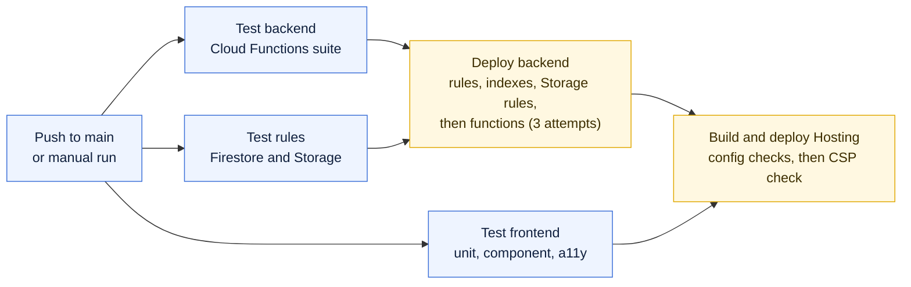

# Deployment

Merging to `main` deploys the backend and the web app to `qcdao-a0c7a`. The live site is [qcdao-a0c7a.web.app](https://qcdao-a0c7a.web.app).

## The pipeline



1. **Tests.** Backend, rules and frontend suites run in parallel.
2. **Deploy backend.** Writes `firebase/functions/.env` from repository variables (`ARBITRUM_SEPOLIA_RPC_URL`, backups, `PRIVY_APP_ID`), deploys Firestore rules, indexes and Storage rules, then deploys all functions. The functions deploy retries up to three times, because Cloud Run can report a timeout while still finishing.
3. **Deploy Hosting.** Checks that the App Check key and Privy app id are set, adds the RPC origins to the CSP, builds with `VITE_FIREBASE_USE_EMULATORS=false`, checks the bundle contains the project id, deploys to the `live` channel and reads the live CSP header back.

The backend always deploys before Hosting. A new frontend against old rules breaks onboarding, publishing and anything that writes a new field or collection.

Pushes that only change `gitbook/**` skip this workflow. Run it by hand from **Actions**, **Deploy**, **Run workflow** to redeploy the current `main`.

## Deploying by hand

Use the same order as the pipeline:

```bash
cd firebase
npx firebase deploy --only firestore:rules,firestore:indexes,storage,functions --project qcdao-a0c7a
cd ..
VITE_FIREBASE_USE_EMULATORS=false npm run build --prefix frontend
cd firebase && npx firebase deploy --only hosting --project qcdao-a0c7a
node scripts/check-csp.mjs https://qcdao-a0c7a.web.app
```

A manual backend deploy reads `firebase/functions/.env` and `.env.qcdao-a0c7a` from your laptop, not the repository variables. Check that `PRIVY_APP_ID` and `ARBITRUM_SEPOLIA_RPC_URL` are set there first: `node firebase/scripts/check-privy-deploy.mjs qcdao-a0c7a`.

## Preview channels

A preview channel serves your branch on a real Hosting URL without touching the live site:

```bash
cd firebase
npm run deploy:preview                       # channel "prod-twin", expires in 7 days
npm run deploy:preview -- staging --expires 1d
npm run deploy:preview -- --backend          # also deploy rules, indexes, Storage rules and functions
```

The preview uses the real production backend and database. Use throwaway test accounts. Rules and functions are shared by every channel, so `--backend` changes them for the live site too. Use it only when the branch needs backend changes and is ready for production data.

Three gates must allow the preview's URL, and each fails closed:

| Gate | Symptom when missing | Who fixes it |
| --- | --- | --- |
| Privy allowed origins | Privy's modal refuses to sign in | You, in the Privy dashboard |
| reCAPTCHA key domains | Every callable returns 401 from App Check | You, on the reCAPTCHA key in Google Cloud |
| Storage CORS | Attachment uploads and downloads fail | The preview script, using `gcloud` |

List and delete channels with `npx firebase hosting:channel:list` and `npx firebase hosting:channel:delete <channel>`, both with `--project qcdao-a0c7a`.

## Contracts

Contracts are not deployed by CI. Deploying a contract does not change the app until the manifests are synced and the backend and Hosting are redeployed. Follow [Switching the app to a new deployment](../repository/smart-contracts.md#switching-the-app-to-a-new-deployment).

## After every release

* Open the live site in a fresh browser profile and sign in.
* Check DevTools for CSP, App Check and Privy errors on the page and in the Privy wallet iframe.
* Check **Admin Audit**, **Service health**.
* Watch the function logs for the next few minutes, especially the one-minute scheduled jobs.

## Rolling back

| What broke | Fastest fix |
| --- | --- |
| The web app | Firebase console, **Hosting**, release history, roll back to the previous release. Then revert the commit on `main` |
| Functions or rules | Revert the commit on `main` and let the pipeline redeploy, or deploy the previous commit by hand |
| A contract switch | Restore the previous manifests from Git history and redeploy backend and Hosting. On-chain records stay where they are |

Revert backend changes and Hosting together if the frontend depends on the new backend.
