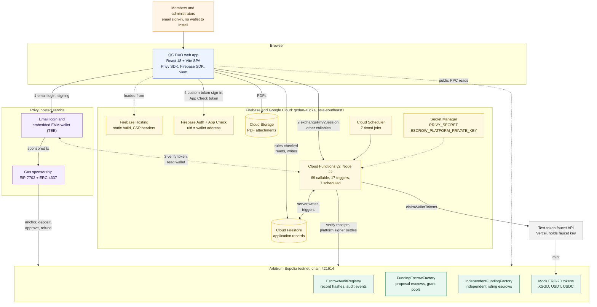
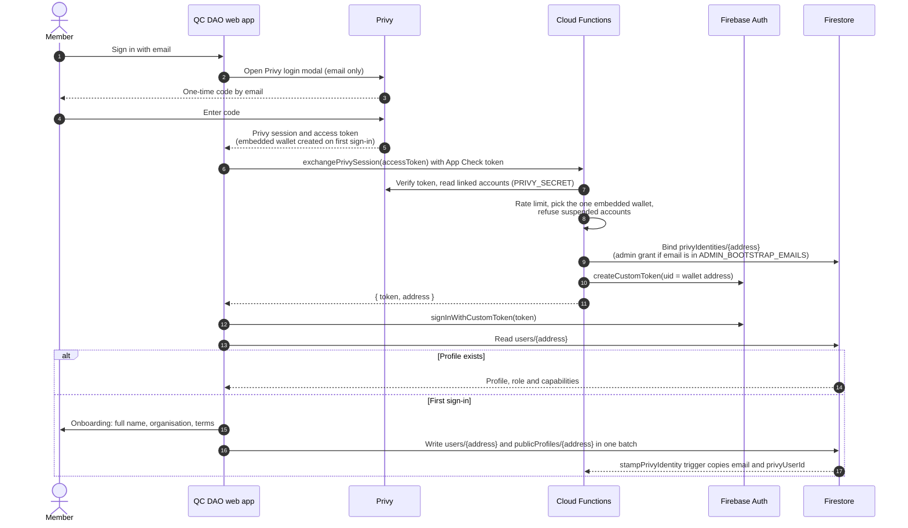

# Architecture

QC DAO is a single-page React app served by Firebase Hosting. It talks to three back ends: Privy for sign-in, wallets and gas, Firebase for data and server logic, and Arbitrum Sepolia for verifiable records and escrow. A small Vercel service mints test tokens.

## System diagram

Numbers 1 to 4 trace sign-in. Dotted lines are configuration or optional paths.



PNG and SVG exports of this page's diagrams are in `docs/architecture/` for slides and reports. See [Regenerating the exports](#regenerating-the-exports).

## Components

| Component | Role | Where it lives |
| --- | --- | --- |
| Web app | Hash-routed React app. Calls Privy for sign-in and signing, Firebase for data, and reads the chain with viem | `frontend/` |
| Firebase Hosting | Serves the build from `firebase/public` with a strict Content-Security-Policy | `firebase/firebase.json` |
| Firebase Auth | Holds sessions minted from custom tokens. The uid is the lowercase wallet address | `firebase/functions/privySession.js` |
| App Check | Attests the web app with reCAPTCHA Enterprise. Callable functions refuse calls without it outside the emulator | `frontend/src/lib/firebase.js` |
| Cloud Functions | 93 functions: sign-in, privileged reads, publication checks, audit confirmation, escrow settlement, moderation, scheduled jobs | `firebase/functions/` |
| Cloud Firestore | Application records, guarded by security rules | `firebase/firestore.rules` |
| Cloud Storage | PDF attachments for postings and proposals, guarded by storage rules | `firebase/storage.rules` |
| Secret Manager | `PRIVY_SECRET` and `ESCROW_PLATFORM_PRIVATE_KEY`, bound to the functions that need them | Google Cloud |
| Cloud Scheduler | Runs the seven scheduled functions | Created by the functions deploy |
| Privy | Email one-time-code login, embedded EVM wallets in a trusted execution environment, gas sponsorship | Privy dashboard |
| Smart contracts | Record hashes, audit events, per-proposal escrows, grant pools and independent listing escrows | `contracts/` |
| Test-token faucet | Mints mock XSGD, USDT and USDC. Holds the faucet key so Firebase never does | `contracts/stable-faucet/site`, on Vercel |
| GitHub Actions | Tests every change and deploys `main` to Firebase | `.github/workflows/` |

## Design decisions to keep

These decisions run through the whole codebase. Changing one usually means changing rules, functions and the frontend together.

1. **The wallet address is the account.** The Firebase uid, the `users/{address}` document id and every on-chain actor are the same lowercase address. Email is stored by the server and never used as an id.
2. **The browser never names its own account.** `exchangePrivySession` verifies Privy's access token with the app secret, reads the single embedded wallet linked to that email and mints the custom token itself. An address sent by the browser can only agree with Privy's.
3. **Chain first, then Firestore.** Publishing, correcting or withdrawing a posting or proposal asks the wallet to anchor the exact hash before the record is stored. A declined transaction leaves nothing half-published.
4. **Only the server writes `confirmed`.** The browser stores a pending receipt with the transaction hash. `confirmProposalAudit` and the scheduled retry worker check the mined transaction, chain, registry, actor and calldata, wait for two confirmations and then mark it confirmed.
5. **One hashing implementation.** The frontend imports 17 shared modules from `firebase/functions` (for example `auditCanonical.js`, `proposalAuditPayload.js`, `escrowProposalTerms.js` and `workflowStatus.js`), so browser and server compute identical hashes and statuses. This is why the frontend tests install the functions dependencies.
6. **Rules are the authorisation layer.** Clients read and write Firestore directly where rules can express the check. Anything that needs cross-document or private data goes through a callable function. Server-only collections have no client rule at all.
7. **Members never pay gas.** Every member transaction is sponsored through Privy. The wallet is upgraded in place with EIP-7702 and sent through an ERC-4337 bundler, so Cloud Functions verify the member's own call inside the bundled transaction (`memberCall.js`) rather than the transaction sender.
8. **Payouts need a platform signer.** Escrow settlement, cancellation and moderation voids are sent by the platform wallet from Cloud Functions. A durable transaction outbox stores each signed transaction before broadcast so retries never pay twice.
9. **Backend before Hosting.** Rules, indexes and functions deploy before the frontend, because a new frontend against old rules breaks onboarding and publishing.
10. **Contract addresses and ABIs come from manifests.** `auditRegistry.contract.json` and `independentFunding.contract.json` exist in both `frontend/src/config` and `firebase/functions`. Old deployments stay verifiable through `auditRegistry.history.json`. Never pair an address with a different contract's ABI.

## Sign-in sequence



A session ends on sign-out, after one hour without activity, or when an administrator suspends the account. Each of these ends both the Privy and the Firebase session. Sign-out calls `revokeOwnSessions`, which writes a cutoff to `sessionRevocations/{address}` and revokes Firebase refresh tokens, so every device is signed out.

## Publishing a record

1. The form builds the final record and its canonical hash in the browser.
2. The app simulates the contract call, then asks the embedded wallet to send it with gas sponsorship.
3. Once the transaction is mined, the app calls `attestPublication`. The server checks that the mined transaction anchors exactly this content and writes a proof to `publicationProofs`.
4. The app writes the record to Firestore. The rules refuse a published record without a matching proof, so nothing can skip the chain.
5. For proposals, the stored receipt starts as `pending`. A trigger queues an audit job, and `confirmProposalAudit` or the one-minute retry job marks it `confirmed` after two block confirmations.
6. Readers open the receipt at any time. It re-reads the record, recomputes the hash and shows **Verified match**, **Mismatch detected** or **Unable to verify**.

## Regenerating the exports

The Mermaid blocks on this page are the source of truth. GitBook and GitHub render them directly. To refresh the PNG and SVG copies in `docs/architecture/`, run from the repository root:

```bash
mkdir -p /tmp/qcdao-diagrams
MMDC="npx -y -p @mermaid-js/mermaid-cli@11 mmdc -i gitbook/overview/architecture.md -o /tmp/qcdao-diagrams/architecture.md -c docs/architecture/mermaid-config.json -b white"
$MMDC -e png -w 1600 -s 2
$MMDC -e svg
cp /tmp/qcdao-diagrams/architecture-1.png docs/architecture/system-architecture.png
cp /tmp/qcdao-diagrams/architecture-2.png docs/architecture/sign-in-sequence.png
cp /tmp/qcdao-diagrams/architecture-1.svg docs/architecture/system-architecture.svg
cp /tmp/qcdao-diagrams/architecture-2.svg docs/architecture/sign-in-sequence.svg
```

The numbers follow the order of the Mermaid blocks on this page, so keep the system diagram first. `mermaid-config.json` sets the font and colours for the exports only. GitBook and GitHub use their own theme.
